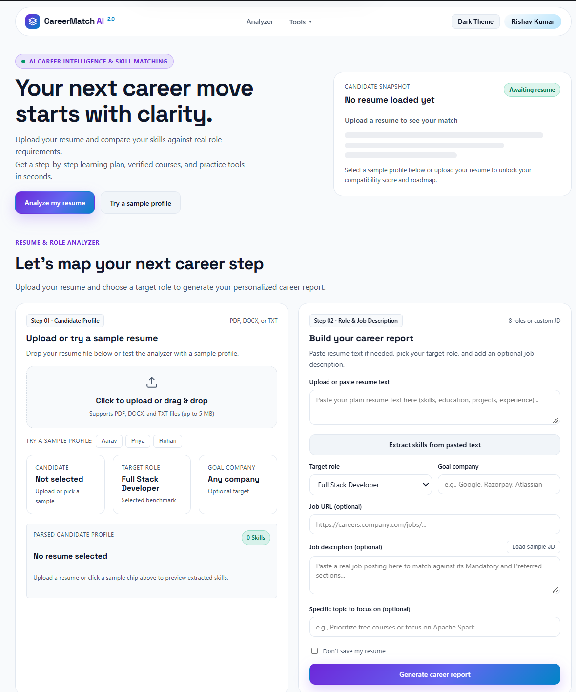
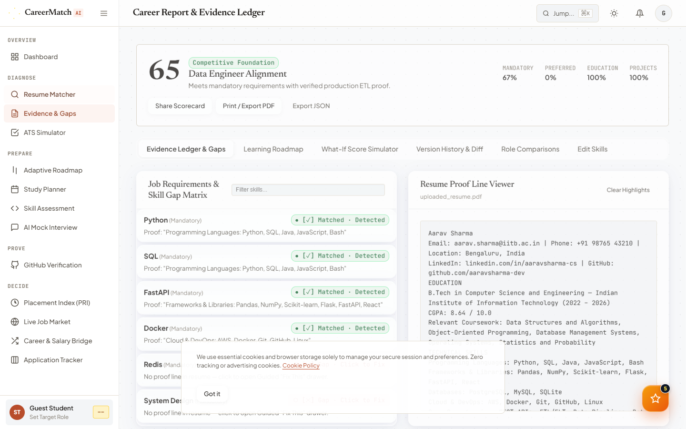
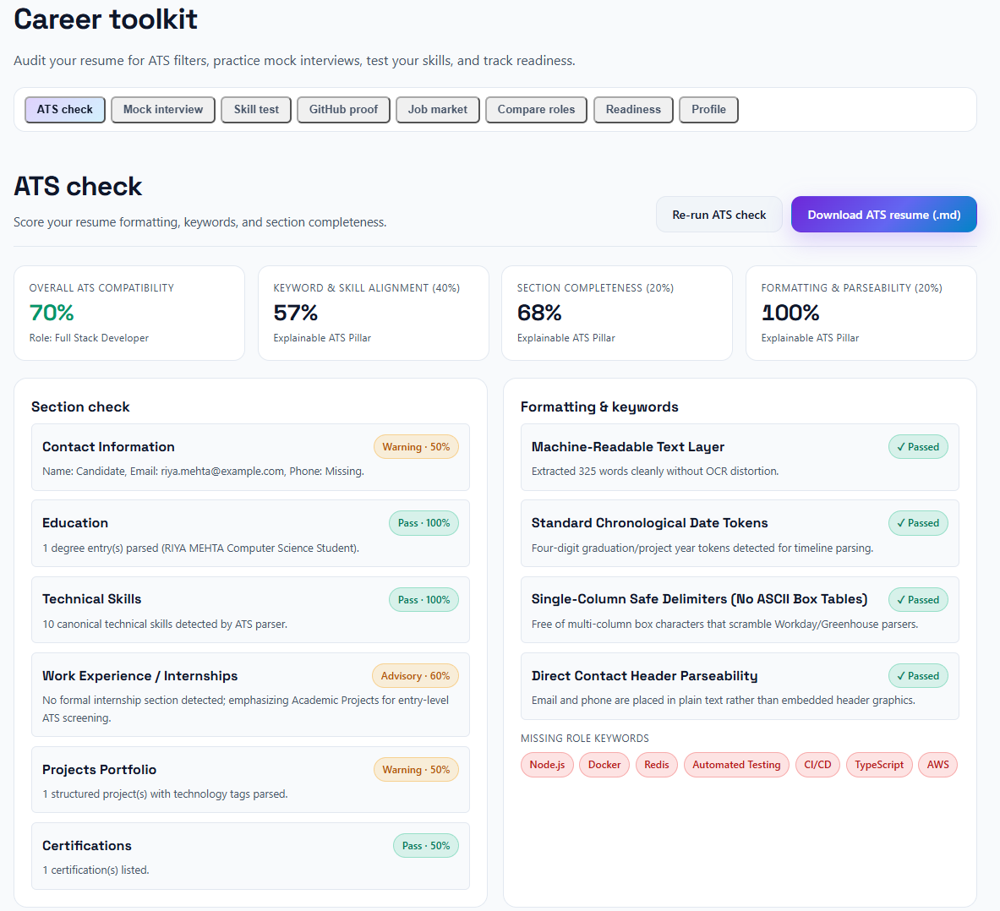
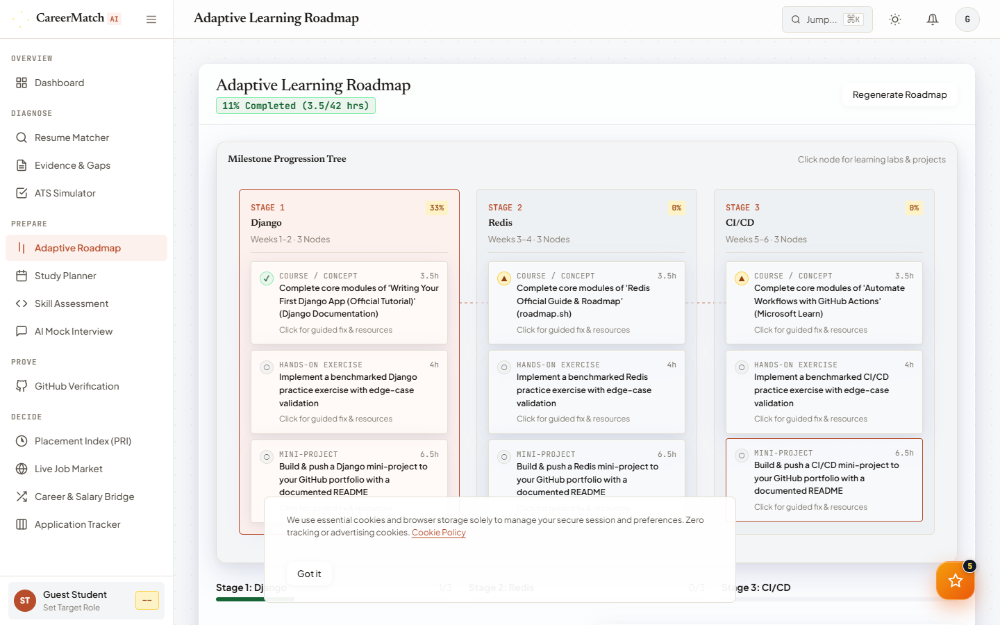
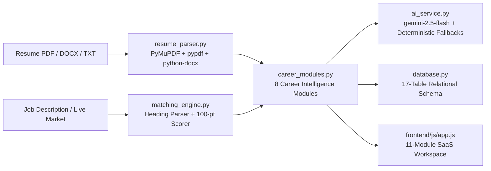

# CareerMatch AI 2.0

**Team Token Titans**

AI-Powered Career Intelligence, Skill Development, and Placement Readiness Platform for students and early-career software/data engineers.

[](https://github.com/shubhamsharma200212-coder/Token_Titans/actions/workflows/test.yml)


**Quick demo:** Click **Demo Mode (Aarav)** in the top bar or upload [`samples/sample_resume_aarav_sharma.txt`](samples/sample_resume_aarav_sharma.txt) and paste [`samples/sample_jd_data_engineer.txt`](samples/sample_jd_data_engineer.txt) (or click **Load sample Data Engineer JD**) to explore the resume analyzer and all 8 CareerMatch AI 2.0 modules.

---

## Demo

- **Live Demo:** [ADD: live demo link]
- **Demo Video (60–90s):** [ADD: 60-90s demo video link]

| Hero & Analyzer | Career Report & Score Breakdown |
| :---: | :---: |
|  |  |

| Skill Gaps & Evidence Table | Interactive Roadmap & Node Inspector | Mobile View |
| :---: | :---: | :---: |
|  |  |  |

---

## Overview & Preserved Core Features

CareerMatch AI 2.0 preserves all original resume-to-JD matching capabilities while expanding the platform into an 11-workspace Career Intelligence suite:

1. **Multi-format resume parsing:** Extracts contact details, education, work experience, projects, certifications, and 38 cataloged technical skills from PDF (`PyMuPDF` / `fitz` + `pypdf`), DOCX (`python-docx`), or plain text.
2. **Heading-aware JD requirement extraction:** Splits job descriptions into Mandatory, Preferred, and Optional tiers using section headings (`Mandatory Requirements`, `Preferred Qualifications`, `Optional / Bonus`) or Gemini structured JSON extraction (`response_schema`).
3. **Explainable 100-point score breakdown:** Scores only verified matches across Mandatory Skills (60%), Preferred Skills (15%), Projects & Experience (15%), Education (5%), and Certifications (5%), with zero padded baselines.
4. **Requirement-to-resume evidence table:** Displays every job requirement alongside its single status (`Detected`, `Adjacent skill`, or `Missing`), the exact quote from the JD, and the supporting line from the resume.
5. **4-phase roadmap with progress tracking:** Builds a clickable skill tree with a sticky node inspector, completion checkboxes persisted to the relational database, and verified Free + Paid courses from `backend/resources.json`.
6. **What-if score simulator & grounded bullet rewrites:** Lets users toggle missing skills to see exact point gains (`+60/N` mandatory, `+15/M` preferred) and rewrites existing resume bullets using Gemini (`gemini-2.5-flash`) or a deterministic fallback.
7. **Saved analysis history & privacy controls:** Stores analysis history across sessions and includes a **"Don't save my resume"** checkbox to bypass persistence.

---

## CareerMatch AI 2.0 — 8 Advanced Modules

### Module 1: Live Job Market Intelligence (`/api/jobs/market`)
- Fetches live public job postings (Remotive public API with timeout protection) and merges or falls back to a clearly labelled **Curated Benchmark Dataset** (`India & Global Tech Roles`) when offline or rate-limited.
- Extracts required skills per listing, computes a live **Resume Match %** against the active student profile, and visualizes top trending skills and company-tier skill patterns (`Product Giants`, `High-Growth Unicorns`, `Cloud & Enterprise`).
- Supports filtering by role, location, experience level, and work mode.

### Module 2: AI Mock Interview Simulator (`/api/interview/*`)
- Supports **Technical**, **HR**, **Behavioral (STAR)**, and **Company-Style** rounds across Beginner, Intermediate, and Advanced difficulty levels.
- Conducts interviews **one question at a time** with both text answers and browser **Web Speech API** voice dictation.
- Evaluates each response across 5 rubric dimensions: **Technical Accuracy**, **Communication Clarity**, **Relevance**, **Problem-Solving Depth**, and **Textual Specificity Indicator** (labelled transparently as a text-based metric rather than acoustic voice analysis).
- Provides a mistake breakdown, strong sample answer, contextual follow-up prompt, and persistent session history.

### Module 3: ATS Resume Simulator (`/api/ats/evaluate`)
- Calculates an explainable **ATS Compatibility Score (0–100)** broken down across **Keyword Alignment (40%)**, **Section Completeness (20%)**, **Formatting & Parseability (20%)**, and **Impact & Measurability (20%)**.
- Audits section presence, formatting checks, missing mandatory/preferred keywords, and weak action verbs.
- Generates **truthful Before/After bullet improvements** grounded strictly in the candidate's existing projects and skills (using `[X]%` / `[N]` placeholders where metrics are needed instead of fabricating credentials) and exports an ATS-optimized Markdown resume (`.md`).

### Module 4: GitHub Skill Verification & Portfolio Analyzer (`/api/github/analyze`)
- Connects to the **GitHub REST API** (`/users/{username}` and `/users/{username}/repos`) with an instant **Demo Mode** fallback (`aarav-sharma-dev`) when offline or unauthenticated.
- Verifies skills evidenced in public repository languages, topics, and descriptions against skills claimed on the student's resume (`Verified in Both`, `Resume Only — Needs Proof`, `GitHub Only — Add to Resume`).
- Audits repository README/documentation indicators, deployment links, and test signals while explicitly noting that stars and commit counts are not direct proof of engineering expertise.

### Module 5: Adaptive AI Learning Roadmap (`/api/roadmap/adaptive`, `/api/roadmap/task`, `/api/roadmap/quiz`)
- Generates a structured 4-stage learning plan with daily and weekly tasks, curated Free & Paid resources, practice links, and milestone project checkpoints.
- Includes interactive **Stage Quizzes**; if a student scores below **80%**, the engine automatically injects targeted **Adaptive Remediation Tasks** into that stage and persists the updated plan.

### Module 6: AI Skill Assessment Lab (`/api/assessment/*`)
- Generates assessments across **Python, SQL, Data Structures & Algorithms, Java, JavaScript, Aptitude, and Technical Fundamentals** at Beginner, Intermediate, or Advanced difficulty.
- Combines timed **Multiple-Choice Questions (MCQs)** with a **Hands-On Coding Challenge**.
- Evaluates code submissions using a **Sandboxed Non-Executing Static AST & Test-Case Verifier** (`ast.parse` structural analysis + complexity/edge-case rubric — never executing arbitrary user code via `eval`/`exec`/`subprocess`).

### Module 7: Career Path & Salary Intelligence (`/api/career/compare`)
- Compares 2 to 4 career paths side by side across current resume match %, core vs. missing skills, fresher/mid/senior **India (INR LPA)** and **Global (USD)** salary ranges (with cited benchmark sources), and 5-year progression timelines.
- Computes a **Role-to-Role Skill Bridge** showing transferable skills and new skills required to pivot from Role A to Role B.

### Module 8: Placement Readiness Index — PRI (`/api/readiness/index`)
- Computes a unified, explainable **0–100 Placement Readiness Index** combining 6 configurable weighted pillars:
  - **Technical Skills (25%)**
  - **Resume & ATS Quality (15%)**
  - **Mock Interview Performance (20%)**
  - **GitHub Portfolio Evidence (15%)**
  - **Skill Assessment Lab (15%)**
  - **Market Alignment (10%)**
- Clearly labels whether each pillar is backed by **Verified Activity** or a **Baseline Estimate**, and outputs top strengths, weaknesses, and prioritized next actions.

---

## Architecture & Database Schema



- **17-Table Relational Schema:** Defined in `backend/mysql_schema.sql` (MySQL 8.0+ DDL) and automatically provisioned in `backend/database.py` (`users`, `student_profiles`, `resumes`, `resume_analyses`, `job_listings`, `job_matches`, `skill_records`, `skill_gaps`, `interview_sessions`, `interview_questions_answers`, `github_profiles`, `learning_roadmaps`, `learning_tasks`, `assessment_sessions`, `assessment_results`, `career_comparisons`, `placement_readiness_reports`).

---

## How the Resume Match Score Is Calculated

Each job requirement is evaluated once and assigned a single status: **Matched** (full weight), **Adjacent** (candidate knows a related technology in `ADJACENT_SKILLS`, e.g., knowing `Flask` when `FastAPI` is required — **0 points credited**), or **Missing** (0 points). A resume with zero detected technical skills is capped at `5.0%` (always under 10).

| Category | Weight | How Raw Score (0–100) Is Computed | Max Points |
| :--- | :---: | :--- | :---: |
| **Mandatory Skills** | 60% | `(matched_mandatory / total_mandatory) * 100` | 60.0 |
| **Preferred Skills** | 15% | `(matched_preferred / total_preferred) * 100` | 15.0 |
| **Projects & Experience** | 15% | `30 pts` per project (up to 60) + `40 pts` per internship/job (up to 40); `0` if 0 skills detected | 15.0 |
| **Education** | 5% | `100` if a degree pattern (`B.Tech`, `B.E.`, `B.Sc`, `M.Tech`, `MCA`, etc.) is detected, else `0` | 5.0 |
| **Certifications** | 5% | `50 pts` per extracted certification line (up to 100 for 2+ certifications) | 5.0 |

---

## Tech Stack

| Layer | Technology | Version | Purpose |
| :--- | :--- | :--- | :--- |
| **Backend API** | Python + FastAPI + Uvicorn | `0.115.6` / `0.34.0` | REST endpoints, static file serving, JWT auth, security headers (`main.py`) |
| **AI Service** | Google GenAI SDK (`google-genai`) | `1.5.0` | Structured JSON extraction, interview rubric & bullet rewrites with `gemini-2.5-flash` |
| **Document Parsing** | `PyMuPDF` (`fitz`), `pypdf`, `python-docx` | `1.25.1` / `5.1.0` / `1.1.2` | PDF page extraction and DOCX paragraph/table parsing |
| **Database** | MySQL (`PyMySQL`) & SQLite (`sqlite3`) | `1.1.1` / Built-in | 17-table relational schema (`mysql_schema.sql` & `database.py`) |
| **Authentication** | JWT (`HMAC-SHA256` + `PBKDF2-SHA256`) | Built-in | Stateless JWT bearer tokens, user registration/login, and 1-click Demo Mode |
| **Testing** | `pytest` | `8.3.4` | Automated unit & integration tests in `tests/test_basic.py` and GitHub Actions CI |
| **Frontend** | HTML5, CSS3, Vanilla JS | ES6+ | 11-module SaaS workspace, Dark/Light theme, interactive SVG charts, Web Speech API |

---

## Quick Start

### Prerequisites
- **Python 3.10+**
- **Google Gemini API Key** *(Optional — if omitted, all modules run in deterministic `template` / benchmark mode)*

### Windows (Command Prompt / PowerShell)
```bat
git clone https://github.com/shubhamsharma200212-coder/Token_Titans.git
cd Token_Titans
python -m venv venv
venv\Scripts\activate
pip install -r requirements.txt
copy .env.example .env
uvicorn backend.main:app --reload --host 127.0.0.1 --port 3000
```
*(Or double-click `run_windows.bat` to run all setup steps and launch on `http://127.0.0.1:3000`.)*

### macOS / Linux
```bash
git clone https://github.com/shubhamsharma200212-coder/Token_Titans.git
cd Token_Titans
python3 -m venv venv
source venv/bin/activate
pip install -r requirements.txt
cp .env.example .env
uvicorn backend.main:app --reload --host 127.0.0.1 --port 3000
```
Open `http://127.0.0.1:3000` in your browser (or `http://127.0.0.1:3000/docs` for FastAPI Swagger UI).

---

## Environment Variables

| Variable | Required | Default | Description |
| :--- | :---: | :--- | :--- |
| `GEMINI_API_KEY` | No | `""` (empty) | Google Gemini API key from [Google AI Studio](https://aistudio.google.com/app/apikey). Leave empty to run in deterministic template mode. |
| `GEMINI_MODEL` | No | `gemini-2.5-flash` | Gemini model identifier used by `backend/ai_service.py` (loaded via `backend/config.py`). |
| `DATABASE_PATH` | No | `careermatch.db` | File path for the local SQLite database created on startup. |
| `DATABASE_URL` | No | `""` (empty) | Optional MySQL connection URL (see `backend/mysql_schema.sql` for MySQL 8.0+ DDL). |
| `JWT_SECRET` | No | Dev secret | Secret key used to sign and verify HMAC-SHA256 JWT tokens. |
| `GITHUB_TOKEN` | No | `""` (empty) | Optional GitHub personal access token for higher rate limits on `/api/github/analyze`. |
| `PORT` | No | `3000` | Server port used across `app.py`, `backend/main.py`, `.env.example`, and `run_windows.bat`. |

---

## Project Structure

```text
Token_Titans/
├── .github/
│   └── workflows/
│       └── test.yml              # GitHub Actions CI workflow running pytest on every push
├── app.py                        # Root entry point with dependency bootstrapper; delegates to backend.main
├── backend/
│   ├── __init__.py               # Backend package marker
│   ├── config.py                 # Centralized env config (GEMINI_API_KEY, GEMINI_MODEL, DATABASE_PATH, JWT_SECRET, PORT)
│   ├── main.py                   # FastAPI routes, ThreadingHTTPServer fallback, and static file mounting
│   ├── career_modules.py         # JWT auth, Central Student Profile, and CareerMatch AI 2.0 Modules 1–8
│   ├── matching_engine.py        # 8 role templates, JD heading parser, 100-pt scorer, and roadmap node builder
│   ├── resume_parser.py          # PDF (PyMuPDF + pypdf), DOCX & TXT extraction, 38-skill catalog, whole-word matcher
│   ├── ai_service.py             # Gemini API calls, response_schema verification, and template fallbacks
│   ├── database.py               # 17-table relational schema + legacy tables and parameterized SQL queries
│   ├── mysql_schema.sql          # Production MySQL 8.0+ DDL for all 17 normalized tables
│   └── resources.json            # 32 curated skills with verified Free & Paid course URLs and subtopics
├── frontend/
│   ├── index.html                # 11-module SaaS workspace + Hero, Analyzer, and 5-tab Career Report
│   ├── css/
│   │   └── styles.css            # Responsive dark cosmic + light paper theme, sidebar layout, and module UI
│   └── js/
│       └── app.js                # Frontend state management, Fetch API client, and controllers for Modules 1–8
├── index.html                    # Root HTML entry fallback
├── samples/
│   ├── sample_resume_aarav_sharma.txt  # Sample B.Tech CS student resume for instant testing
│   └── sample_jd_data_engineer.txt     # Sample Data Engineer JD with Mandatory, Preferred, and Optional sections
├── scripts/
│   └── check_links.py            # Utility script that requests every URL in backend/resources.json
├── tests/
│   └── test_basic.py             # Pytest suite verifying core matching + CareerMatch AI 2.0 Modules 1–8
├── docs/
│   └── screenshots/
│       └── README.txt            # Checklist of the 5 screenshots referenced in this README
├── requirements.txt              # Pinned Python dependencies (FastAPI, Uvicorn, PyMuPDF, pypdf, python-docx, PyMySQL, pytest)
├── package.json                  # Runner and syntax check scripts
├── metadata.json                 # Application metadata
├── .env.example                  # Environment variable template (safe empty defaults)
├── .gitignore                    # Git ignore rules (excludes *.db, .env, venv, .aistudio, public, bun.lock)
├── run_windows.bat               # One-click Windows virtual environment setup and Uvicorn launcher (port 3000)
└── LICENSE                       # MIT License
```

---

## API Reference

| Method | Path | Purpose |
| :--- | :--- | :--- |
| `GET` | `/api/health` | Health check returning status, stack, and active modules count. |
| `GET` | `/api/bootstrap` | Returns the 8 role templates, 3 sample resumes, default weights, PRI weights, and demo profile. |
| `POST` | `/api/auth/register` | Registers a student account and returns a signed JWT + profile. |
| `POST` | `/api/auth/login` | Authenticates credentials or logs into the Demo Student account (`demo: true`). |
| `GET` / `PUT` | `/api/profile` | Reads or updates the Central Student Career Profile (`student_profiles`). |
| `POST` | `/api/resume/parse` | Parses base64-encoded file bytes (`PDF`/`DOCX`/`TXT`) or `pastedText`; respects `dontSave`. |
| `POST` | `/api/resume/upload` | Multipart file upload endpoint (`UploadFile`) that parses and saves a resume profile. |
| `POST` | `/api/analyze` | Runs resume-to-JD matching, 8-role comparison, roadmap generation, and Gemini/template recommendations. |
| `GET` | `/api/jobs/market` | **Module 1:** Fetches live/benchmark job market listings, trending skills, and resume match %. |
| `POST` | `/api/interview/start` | **Module 2:** Starts an adaptive Technical, HR, Behavioral, or Company-Style mock interview session. |
| `POST` | `/api/interview/answer` | **Module 2:** Evaluates an interview answer on 5 rubric metrics and returns the next question. |
| `GET` | `/api/interview/history` | **Module 2:** Returns past mock interview sessions for the student. |
| `POST` | `/api/ats/evaluate` | **Module 3:** Computes the 4-pillar ATS score, section/format checks, bullet rewrites, and `.md` export. |
| `POST` | `/api/github/analyze` | **Module 4:** Analyzes GitHub repos vs. resume skill claims and audits documentation quality. |
| `POST` | `/api/roadmap/adaptive` | **Module 5:** Generates or loads the 4-stage adaptive roadmap with tasks and stage quizzes. |
| `PUT` | `/api/roadmap/task` | **Module 5:** Toggles completion of a learning task and updates mastery progress. |
| `POST` | `/api/roadmap/quiz` | **Module 5:** Grades a stage quiz and injects adaptive remediation tasks if score < 80%. |
| `POST` | `/api/assessment/generate` | **Module 6:** Generates an MCQ + coding assessment session for a selected topic and difficulty. |
| `POST` | `/api/assessment/submit` | **Module 6:** Evaluates MCQ answers and runs the non-executing AST verifier on code submissions. |
| `POST` | `/api/career/compare` | **Module 7:** Compares multiple roles across match %, salary ranges, and Role-to-Role Skill Bridge. |
| `POST` | `/api/readiness/index` | **Module 8:** Computes the 6-pillar Placement Readiness Index (PRI) with custom weights. |

---

## Running the Tests

Run the automated `pytest` suite (`tests/test_basic.py`):
```bash
pytest
```

Verify that all course URLs in `backend/resources.json` return HTTP 200:
```bash
python3 scripts/check_links.py
```

---

## Team, License & Acknowledgements

- **Team Token Titans:** [ADD: names, roles, links]
- **License:** Distributed under the [MIT License](LICENSE).
- **Acknowledgements:** Built for **Graviton 2026** using the [Google Gemini API (`google-genai`)](https://ai.google.dev/), [FastAPI](https://fastapi.tiangolo.com/), and community learning paths referenced from [roadmap.sh](https://roadmap.sh/).
